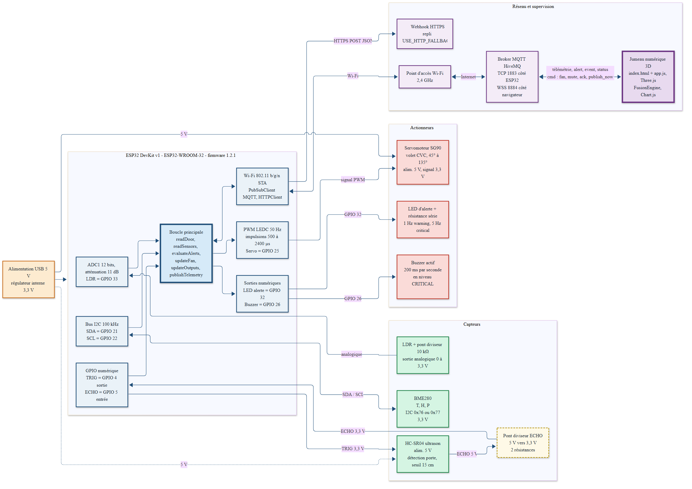
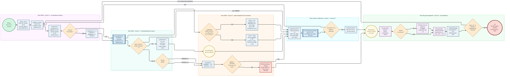

# SMART OPERATING ROOM — DIGITAL TWIN (PROJET 10)
### 🏥 Système de Jumeau Numérique Temps Réel, IoT Médical & IA de Fusion pour Bloc Opératoire (Santé 4.0)

[](https://platformio.org/)
[](https://isocpp.org/)
[](https://threejs.org/)
[](https://www.hivemq.com/)
[](https://www.chartjs.org/)
[](https://developer.mozilla.org/fr/docs/Web/JavaScript)

---

## 🎯 Contexte & Objectif
Système de jumeau numérique temps réel pour la surveillance continue, la conformité environnementale et l'analyse prédictive d'un bloc opératoire hospitalier sous contraintes d'asepsie strictes (Santé 4.0).

Ce projet s'intègre en synergie directe avec la plateforme de robotique chirurgicale **[HUMA-LOG SURGICAL-VLA](https://github.com/imadabail08-hue/HUMA_LOG_SURGICAL_VLA)** pour offrir une supervision médicale globale du bloc opératoire.

---

## 📸 Schémas d'Architecture & Processus Médical

### 1. Architecture Matérielle & Flux de Données


### 2. Modélisation BPMN du Processus Médical


---

## 1. 🚀 Lancement rapide (Sans build ni npm)

L'application est développée en **HTML5, CSS3 pur et JavaScript ES2020 natif**. Elle ne nécessite aucun outil de compilation, ni Node.js, ni bundler.

### Méthode 1 : Avec l'extension VS Code *Live Server*
1. Ouvrez le dossier dans VS Code.
2. Faites un clic droit sur `index.html` → **Open with Live Server**.
3. L'application s'ouvre automatiquement sur `http://127.0.0.1:5500`.

### Méthode 2 : Avec Python (Terminal)
```bash
python -m http.server 8000
```
Ouvrez ensuite votre navigateur sur : [http://localhost:8000](http://localhost:8000).

---

## 2. 📡 Configuration MQTT temps réel

Le Digital Twin est interfacé directement avec le firmware ESP32 via WebSockets sécurisés :

* **Broker public de démonstration** : `wss://broker.hivemq.com:8884/mqtt`
* **Topic de base par défaut** : `sor-p10/bloc-or1`
* **Topics souscrits** : `<base>/#` (incluant `<base>/telemetry`, `<base>/alert`, `<base>/event`)
* **Topic de commande** : `<base>/cmd` (pilotage du servomoteur, sourdine, acquittement)

### Format du contrat JSON reçu (`<base>/telemetry`) :
```json
{
  "device": "esp32-or1",
  "fw": "1.2.1",
  "seq": 142,
  "ts": 1792758625,
  "temperature": 21.4,
  "humidity": 48.0,
  "pressure_hpa": 1018.0,
  "lux": 320,
  "ldr_raw": 1310,
  "door": "closed",
  "door_distance_cm": 8.5,
  "fan": false,
  "fan_mode": "auto",
  "servo_angle": 0,
  "alerts": []
}
```

---

## 3. ⚖️ Règles cliniques & Seuils de conformité

| Grandeur | Plage normale | Avertissement (WARNING) | Critique (CRITICAL) | Règle d'action locale |
| :--- | :--- | :--- | :--- | :--- |
| **Température** | 20,0 – 24,0 °C | < 20 °C ou > 24 °C | > 26,0 °C | Ventilation ON si T ≥ 23,5 °C ; Forcée ON si > 26 °C |
| **Humidité** | 30 – 60 % | < 30 % ou > 60 % | > 70 % | Ventilation ON si H ≥ 55 % (risque aérobie) |
| **Luminosité** | > 300 lx | < 300 lx | < 100 lx | Assombrissement dynamique de la scène |
| **Porte du sas** | Fermée | Ouverte > 30 s | Ouverte > 120 s | Chronomètre de rupture d'asepsie |
| **Ventilation CVC** | Régulée | Balayage 45° ↔ 135° | Balayage forcé | Servomoteur SG90 pas à pas (3° / 15 ms) |

---

## 4. 🧠 Moteur d'Analyse Fusion AI (Explicable)

Le module `FusionEngine` calcule en continu à chaque trame :

1. **Indice de risque global (0 à 100)** :
   $$\text{Score} = \text{Temp}(35\%) + \text{Hum}(25\%) + \text{Lux}(15\%) + \text{Porte}(25\%) + \text{Bonus Corrélations}$$
2. **Corrélations croisées** :
   * **Risque d'aérocontamination** : Porte ouverte simultanément avec une hausse d'humidité (+1 %/min).
   * **Défaillance de climatisation** : Température > 24 °C avec ventilation inactive.
   * **Conditions dégradées** : Luminosité < 100 lx pendant une ouverture de porte.
3. **Prédiction thermique précoce** : Régression linéaire sur les 60 dernières secondes calculant la pente (°C/min) et anticipant le dépassement du seuil de 24 °C jusqu'à 5 minutes à l'avance.
4. **Détection d'anomalies de mesure** : Détection des sauts brusques (> 3 °C ou > 15 % en 2 secondes) signalant un capteur défaillant.
5. **Anti-bruit** : Cooldown de 60 secondes sur les répétitions et journalisation automatique du *"Retour à la normale"*.

---

## 5. 🖥️ Présentation des 5 vues

1. **Vue d'ensemble (`#overview`)** : Scène 3D WebGL Three.js interactive avec éclairage procédural, table chirurgicale, scialytique, les 4 cartes flottantes glassmorphism (Luminosité, Température, Humidité, Porte), indicateur d'état clinique et indice Fusion AI.
2. **Salle opératoire (`#room`)** : Vue 3D d'inspection avec ciblage caméra GSAP (Table, Scialytique, Porte & Sas, Vue globale), OrbitControls et fiches d'équipements interactives.
3. **Données temps réel (`#live`)** : 3 graphiques Chart.js avec bandes de tolérance chirurgicales et tableau chronologique des 20 dernières mesures.
4. **Événements (`#events`)** : Journal d'audit complet filtrable (Tous, Info, Warning, Critical, Fusion AI), recherche textuelle et acquittement d'alarme.
5. **Rapports (`#reports`)** : Synthèse d'audit clinique et 3 exports certifiés (HTML, CSV, Impression/PDF).

---

## 6. 🔌 Câblage matériel ESP32 (MakerBoard)

| Composant | Rôle & Fonction | Broche / Interface |
| :--- | :--- | :--- |
| **Capteur BME280** | Pression, Température & Humidité | I2C (SDA = GPIO 21, SCL = GPIO 22, adresse 0x77) |
| **Capteur Ultrason HC-SR04** | Détection ouverture porte du sas | TRIG = GPIO 4, ECHO = GPIO 5 |
| **Capteur LDR** | Luminosité ambiante | Pont diviseur 10 kΩ sur GPIO 34 (ADC1) |
| **Servomoteur SG90** | Volet de ventilation CVC orientable | Signal PWM sur GPIO 25 |
| **LED d'alerte** | Alarme visuelle | GPIO 32 |
| **Buzzer actif** | Alarme sonore d'urgence | GPIO 26 |

---

## 📚 Documents Techniques Inclus

- 📄 **Dossier Technique Général (PDF) :** [`output/Dossier_Technique_General.pdf`](output/Dossier_Technique_General.pdf)
- 📊 **Support de Présentation Soutenance :** [`output/presentation_soutenance.pptx`](output/presentation_soutenance.pptx)
- 📐 **Architecture Détaillée :** [`Architecture du projet Smart Operating Room Environment.md`](Architecture%20du%20projet%20Smart%20Operating%20Room%20Environment.md)

---

## 👤 Auteur & Profil

**Imad Abail**
- 🐙 **GitHub :** [@imadabail08-hue](https://github.com/imadabail08-hue)
- 💼 **LinkedIn :** [imad-abail-765440287](https://www.linkedin.com/in/imad-abail-765440287)
- 🎓 **Email Académique :** [imad_abail@um5.ac.ma](mailto:imad_abail@um5.ac.ma)
- 📍 **Localisation :** Rabat, Maroc 🇲🇦
