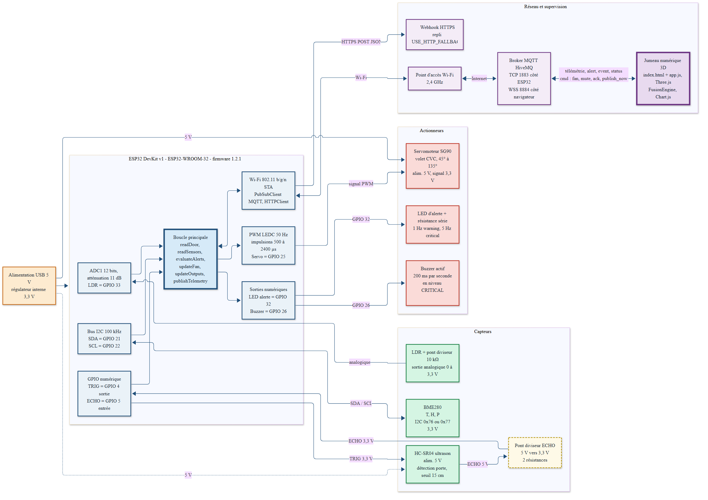
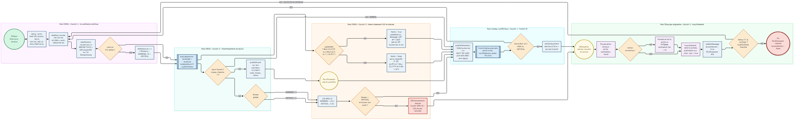

<!-- _class: lead -->
<!-- _paginate: false -->

# Smart Operating Room Environment

## Surveillance environnementale d'un bloc opératoire, ESP32 et jumeau numérique 3D

**Projet 10 · Santé 4.0**

FIRMWARE 1.2.1 PROTOTYPE DE DÉMONSTRATION

Soutenance technique · 24 octobre 2026

<!--
Ouverture : le projet surveille en continu température, hygrométrie, éclairement et porte d'un bloc opératoire, agit localement sur la ventilation, et alimente un jumeau numérique qui calcule un indice de risque explicable.
Préciser dès le départ que c'est un prototype de surveillance complémentaire, pas un système de qualification ISO 14644 ou NF S 90-351.
-->

---

# Enjeux cliniques

## Pourquoi surveiller ?

- **Infections associées aux soins** : l'air, l'humidité et les flux de personnes influencent le risque
- **Porte du sas** : chaque ouverture perturbe la surpression et les flux
- **Confort et sécurité** : chaleur excessive, froid, électricité statique
- **Traçabilité** : un historique daté pour l'audit d'hygiène

## Cadre de référence

| Référence | Rôle |
| :--- | :--- |
| ISO 14644-1 | Classes de propreté particulaire |
| NF S 90-351 | Zones à risque 1 à 4 en santé |
| Zone 4 | ISO 5, flux unidirectionnel, 19 à 26 °C |

VALEURS À VÉRIFIER SUR LE TEXTE EN VIGUEUR

<!--
Les valeurs de la zone 4 proviennent de documentation publique (version 2013). À confirmer sur le texte AFNOR avant tout usage réglementaire.
-->

---

# Périmètre : ce que le système fait, et ne fait pas

## Couvert INCLUS

- Température, humidité, pression (BME280)
- Éclairement indicatif (LDR)
- État de la porte (ultrason HC-SR04)
- Asservissement du volet CVC (servo SG90)
- Alerte LED, buzzer, journal d'audit
- Jumeau 3D et indice Fusion AI

## Hors périmètre EXCLU

- Comptage particulaire, UFC
- Pression différentielle entre locaux
- Pilotage de la vraie centrale de traitement d'air
- Qualification métrologique
- **Preuve de conformité ISO 14644 / NF S 90-351**

<!--
Message clé : surveillance complémentaire des facteurs d'influence de la contamination. La qualification de la salle reste du ressort d'un laboratoire compétent.
-->

---

# Architecture système en quatre couches

## Terrain
BME280 · LDR · HC-SR04 · SG90 · LED · buzzer

## Embarquée
ESP32 DevKit v1 · `loop()` · règles à hystérésis

## Transport
Wi-Fi · MQTT 1883 · WSS 8884 · webhook HTTPS

## Supervision
`app.js` · Three.js · Fusion AI · journal

 

<!--
Le synoptique complet est généré depuis output/architecture_materielle.mmd. Insister sur le fait que l'alerte locale ne dépend pas du réseau.
-->

---

# Architecture matérielle : ESP32 DevKit v1

| GPIO | Signal | Périphérique | Remarque |
| :--- | :--- | :--- | :--- |
| 21 / 22 | SDA / SCL, I²C | BME280 (0x76 ou 0x77) | Détection automatique de l'adresse |
| 33 | ADC1, 12 bits | LDR + 10 kΩ | Moyenne de 16 échantillons |
| 4 / 5 | TRIG / ECHO | HC-SR04 | **Pont diviseur sur ECHO (5 V vers 3,3 V)** |
| 25 | PWM 50 Hz | Servo SG90 | Alimentation 5 V séparée |
| 32 | Sortie | LED d'alerte | 1 Hz warning, 5 Hz critical |
| 26 | Sortie | Buzzer actif | 200 ms par seconde en critical |

LE CODE FAIT FOI README ET EN-TÊTE DU FICHIER À CORRIGER

Écarts relevés : LDR (33 dans le code, 34 dans le README), buzzer, ultrason et adresse du BME280.

<!--
Le dossier technique contient la matrice complète avec tensions et recommandations de câblage. Les écarts de documentation sont listés au chapitre 5.5.
-->

---

# Firmware : seuils et hystérésis

| Alerte | WARNING | CRITICAL |
| :--- | :--- | :--- |
| Température haute | > 24,0 °C | > 26,0 °C |
| Température basse | < 20,0 °C | < 18,0 °C |
| Humidité haute | > 60 % | > 70 % |
| Humidité basse | < 30 % | < 20 % |
| Éclairement | < 300 | < 100 |
| Porte ouverte | > 30 s | > 120 s |

## Asservissement CVC

- ON : **T ≥ 23,5 °C** ou **HR ≥ 55 %**
- OFF : **T ≤ 22,5 °C** et **HR ≤ 50 %**
- Servo : balayage 45° ↔ 135°, pas de 3° / 15 ms
- Critique thermique : ventilation **forcée**

ANTICIPE LE SEUIL DE 24 °C

Hystérésis : 0,5 °C · 2 % HR · 20 sur l'éclairement. Une alerte ne retombe qu'après franchissement de la bande.

<!--
Expliquer l'hystérésis : à 24,2 °C l'alerte se lève, elle ne s'efface qu'à 23,5 °C ou moins, ce qui évite les oscillations autour du seuil.
-->

---

# Processus médical (BPMN 2.0)

Surveillance continue → franchissement de seuils → asservissement CVC → alarme → acquittement soignant.

<!--
Dérouler le diagramme couloir par couloir. Préciser que Mermaid émule la notation BPMN ; un livrable BPMN 2.0 en XML demande un éditeur dédié.
-->

---

# Moteur Fusion AI : un score explicable

$$R=\min\Big(100,\ r_T+r_H+r_L+r_D+B_1+B_2+B_3\Big)$$

| Grandeur | Poids max |
| :--- | :--- |
| Température | 35 |
| Humidité | 25 |
| Éclairement | 15 |
| Porte | 25 |

## Corrélations cliniques

- Porte ouverte **et** humidité en hausse : **+12**
- T > 24 °C **et** ventilation arrêtée : **+10**
- Éclairement < 100 **et** porte ouverte : **+8**

R < 20 LOW 20 à 39 MODERATE 40 à 69 HIGH ≥ 70 CRITICAL

**Prédiction** : régression sur 60 s, alerte si le seuil de 24 °C est atteint en moins de 5 min.

<!--
Règles expertes, déterministes, explicables : ce n'est pas du machine learning. Les pondérations sont à valider cliniquement. Exemple : T=25,2 ; HR=62 ; 250 ; porte 45 s ; ventilation arrêtée donne 68 (HIGH), et 80 (CRITICAL) avec une montée d'humidité de 1,4 %/min.
-->

---

# Démonstration du jumeau numérique 3D

## Scénario de démonstration

1. **État nominal** : 21,4 °C, 48 %, porte fermée, indice 0
2. **Ouverture de porte** : chronomètre d'ouverture, événement journalisé
3. **Dérive thermique** : ventilation, servo en balayage
4. **Alarme critique** : LED rapide, buzzer
5. **Acquittement** puis retour à la normale

## Les 5 vues

| Vue | Contenu |
| :--- | :--- |
| `#overview` | Scène 3D, cartes, indice |
| `#room` | Inspection caméra |
| `#live` | Graphiques temps réel |
| `#events` | Journal, acquittement |
| `#reports` | Audit, export CSV, HTML, PDF |

THREE.JS CHART.JS MQTT / WSS MODES : SIM · MQTT · REPLAY

<!--
Lancer le jumeau (Live Server ou python -m http.server 8000). Le mode simulation permet de dérouler le scénario sans matériel ; le mode MQTT utilise le broker public de démonstration.
-->

---

# Métriques clés

2 s

période de mesure et de publication

150 ms

scrutation de la porte, anti-rebond 80 ms

7

codes d'alerte à deux niveaux

 

| Indicateur | Valeur | Statut |
| :--- | :--- | :--- |
| Graphe Graphify | 69 nœuds · 105 arêtes · 9 communautés | EXTRAIT |
| Alerte locale sans réseau | LED, buzzer, servo autonomes | IMPLÉMENTÉ |
| Détection porte | < 0,5 s attendu | À VALIDER EN RECETTE |
| Précision T / HR | ±0,5 °C / ±3 % attendu | À VALIDER EN RECETTE |
| Éclairement | Indicatif, non étalonné | ÉCART |
| Sécurité des échanges | Broker public, sans authentification | ÉCART |

<!--
Aucun résultat de recette n'est affiché : les essais T-01 à T-23 du dossier technique restent à exécuter. Les valeurs « attendues » sont des critères d'acceptation proposés.
-->

---

# Limites et feuille de route

## Priorité haute À TRAITER

- Sécuriser MQTT : broker privé, TLS, ACL sur `/cmd`
- Sortir la requête HTTPS de la boucle principale
- Acquittement **local** par bouton

## Priorité moyenne PLANIFIÉ

- Contrat de seuils unique firmware / jumeau
- Étalonnage de l'éclairement
- Extraire et tester `FusionEngine`
- Valider les pondérations avec l'hygiène hospitalière

Détail : chapitres 10 et 12 du dossier technique SOR-P10-DTG-001.

<!--
Être franc sur deux points : un acquittement distant sur un broker public peut couper un buzzer critique, et un appel HTTPS bloquant peut figer la boucle de plusieurs secondes.
-->

---

<!-- _class: end -->

# Conclusion

- Une chaîne complète **capteurs → règles locales → MQTT → jumeau 3D**
- Un moteur de risque **explicable**, formalisé mathématiquement
- Un **plan de recette** de 23 essais et une traçabilité exigences / tests
- Un prototype **prêt à être durci**, pas encore à être déployé en clinique

 

ÉTAPE SUIVANTE **Recette en laboratoire, puis sécurisation du transport**

## Merci · Questions

<!--
Clôture : revenir sur la distinction entre surveillance complémentaire et qualification de la salle. Inviter aux questions.
-->
